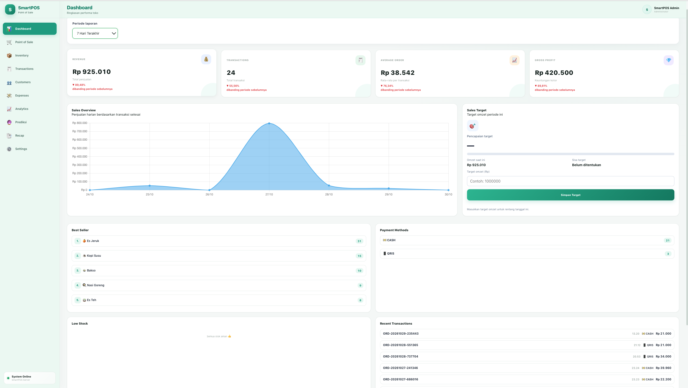
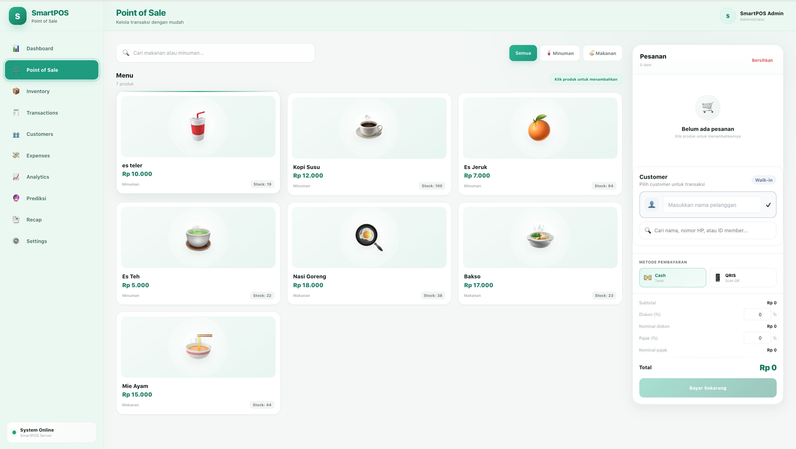
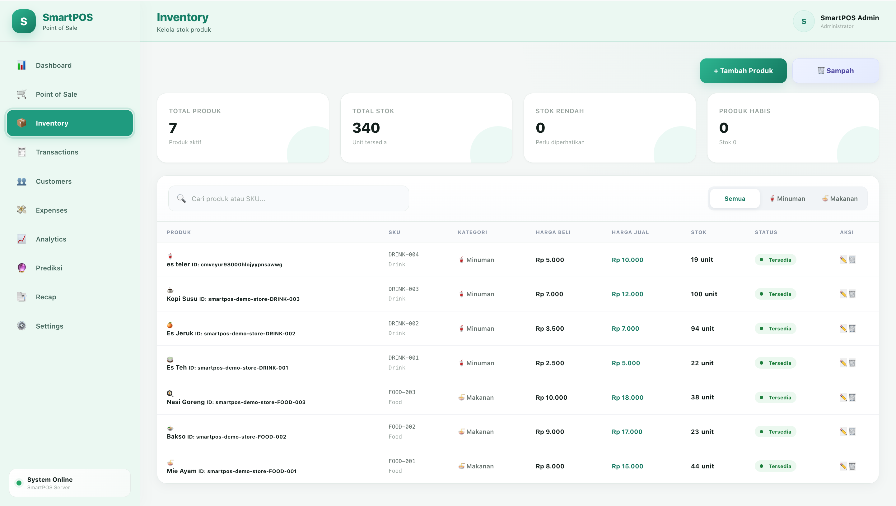
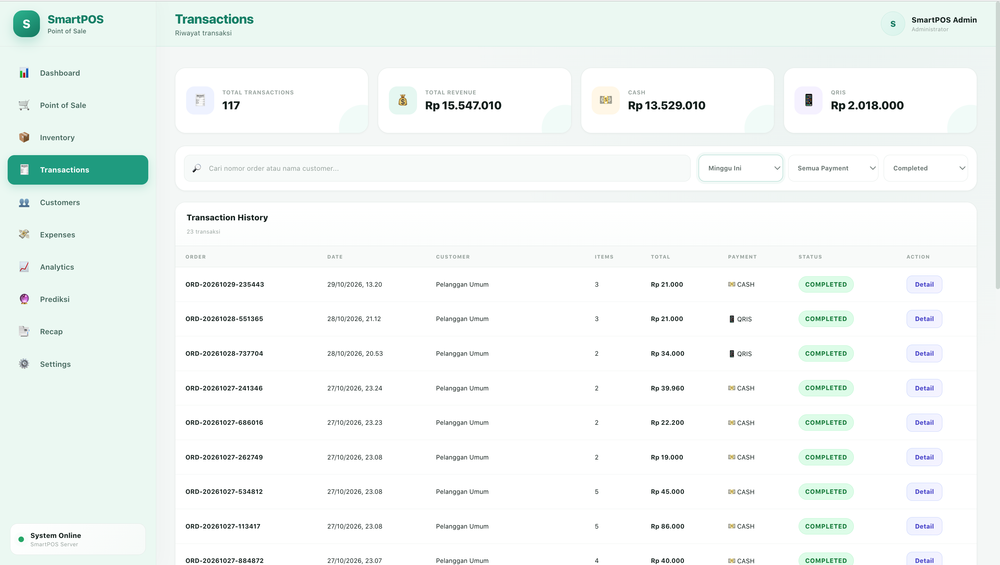
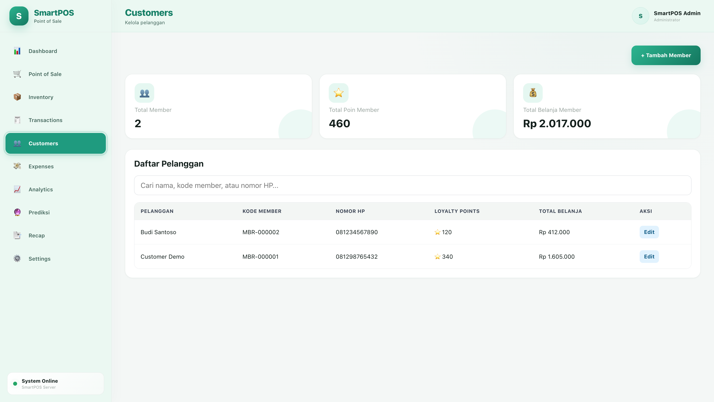
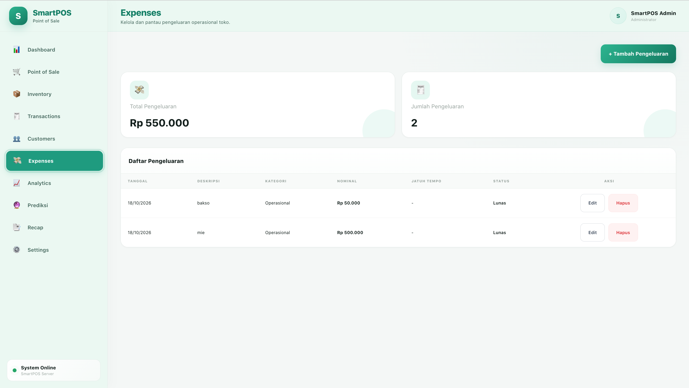
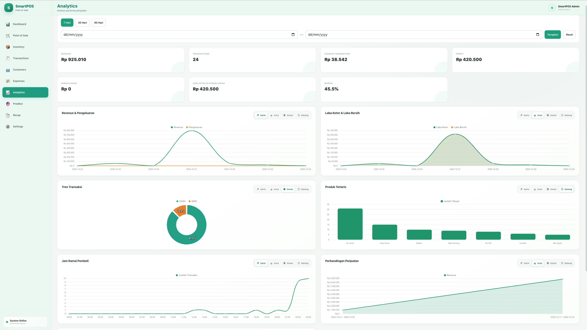
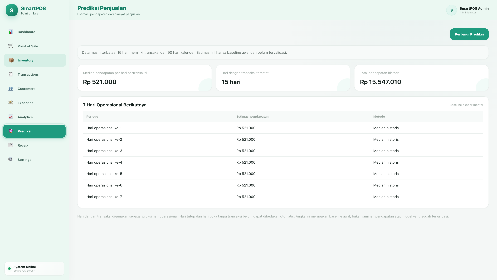
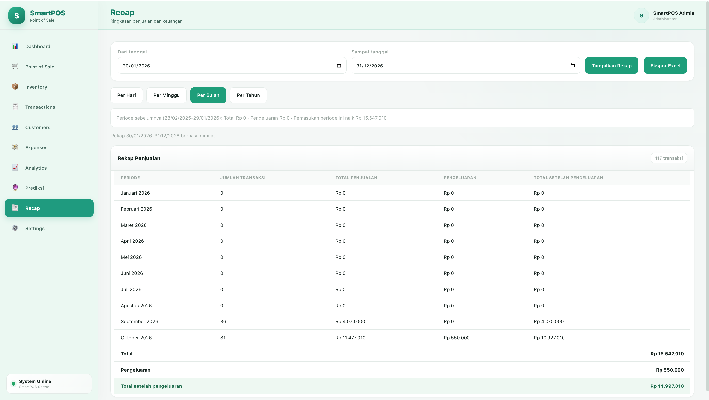
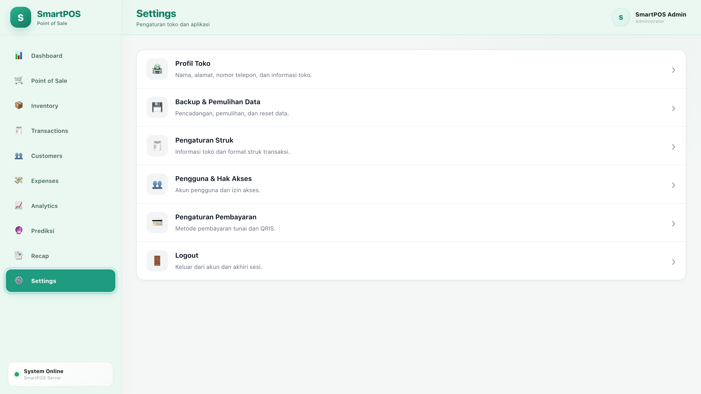

# SmartPOS – Point of Sale Management System

**Language:** [Bahasa Indonesia](./README.md) | English

**Sales Management, Inventory Control & Business Performance Monitoring**

---

## 📌 About the Project

SmartPOS is a web-based Point of Sale (POS) application designed to support integrated sales transaction processing and business operations management. The application consists of ten main modules: **Dashboard, Point of Sale, Inventory, Transactions, Customers, Expenses, Analytics, Prediction, Recap, and Settings**.

These modules support various business operational activities, including sales transaction recording, product and inventory management, transaction history monitoring and refund processing, customer data management, operational expense recording, sales performance analysis, revenue estimation based on historical data, and business report summarization.

SmartPOS is developed using **HTML, CSS, and JavaScript** for the user interface, while **Node.js and Express.js** handle backend logic and API services. Database management is implemented using **Prisma ORM and PostgreSQL**. **Chart.js** supports data visualization, while **Socket.IO** provides real-time communication capabilities according to the application's implementation. In addition, the application includes reporting and data backup utilities to support system management and maintenance.

This project was developed as a personal portfolio project to demonstrate practical skills in web application development, database management, transaction processing, data visualization, and statistical analysis, with the aim of supporting more efficient business operations and data-driven decision-making.

## 🎯 Development Objectives

SmartPOS was developed to provide an integrated digital solution for managing daily store operations.

The main development objectives include:

- Digitizing sales transaction recording and management.
- Simplifying product, category, and inventory management.
- Providing an informative dashboard to monitor business performance.
- Facilitating transaction history searches and reviews.
- Supporting refund recording and management.
- Managing customer information and operational expenses.
- Providing sales and product performance analytics.
- Generating revenue estimates based on historical sales data.
- Providing operational summaries and business reports.
- Supporting application configuration and data maintenance.
- Enabling real-time communication to support application updates.

## 🛠️ Tools & Technologies

| Technology | Purpose |
|---|---|
| HTML5 | Application page structure |
| CSS3 | User interface design and styling |
| JavaScript | Frontend logic and interactions |
| Chart.js | Data visualization and charts |
| Node.js | Backend runtime environment |
| Express.js | REST API and server management |
| PostgreSQL | Relational database |
| Prisma ORM | Database schema, migrations, and data access |
| Socket.IO | Real-time communication |
| Python HTTP Server | Local frontend development server |

## ⚙️ Application Modules & Features

SmartPOS consists of ten main modules that work together to support integrated business operations management.

### 1. Dashboard

The Dashboard provides an overview of the store's operational and financial performance based on the selected reporting period.

The displayed information includes:

- **Total Revenue:** Total sales revenue.
- **Total Transactions:** Number of recorded transactions.
- **Average Transaction Value:** Average value per transaction.
- **Gross Profit:** Estimated gross profit.
- Performance comparison with the previous period.
- Sales performance charts by date.
- Recent transaction activity.

The Dashboard supports several reporting periods: Today, 7 Days, 30 Days, and Custom Date Range, allowing users to monitor business performance over different time frames.

### 2. Point of Sale (POS)

The Point of Sale module is used to process sales transactions directly through the cashier interface.

Available features include:

- Displaying available products.
- Selecting products for transactions.
- Adjusting product quantities.
- Automatically calculating transaction totals.
- Supporting Cash and QRIS payment methods.
- Recording sales transactions in the system.
- Updating inventory based on sales transactions.

### 3. Inventory

The Inventory module is used to manage product information and monitor stock availability.

Available features include:

- Adding new products.
- Updating product information.
- Grouping products by category.
- Monitoring stock quantities.
- Deleting products.
- Viewing deleted products through the Trash feature.
- Restoring products from the Trash list.

### 4. Transactions

The Transactions module is used to record, display, and monitor sales transaction activities.

Available features include:

- Displaying transaction history.
- Monitoring Cash and QRIS payment methods.
- Viewing transaction details.
- Monitoring transaction statuses.
- Distinguishing transactions based on their completion status.
- Displaying refund information associated with transactions.

**Refund Management**

Refund management is available through transaction details and supports the processing of customer refunds.

Refund features include:

- Creating refund requests.
- Viewing refund history.
- Supporting cash and QRIS/bank transfer refund methods.
- Confirming refund requests.
- Cancelling refund requests.
- Monitoring refund statuses: Pending, Completed, and Cancelled.

### 5. Customers

The Customers module is used to manage customer information stored in the system.

Available features include:

- Displaying customer lists.
- Adding customer records.
- Updating customer information.
- Managing stored customer data.
- Facilitating customer information searches and management.

### 6. Expenses

The Expenses module is used to record and monitor store operating expenses.

Available features include:

- Recording operational expenses.
- Managing expense information.
- Displaying expense history.
- Monitoring total expenses by reporting period.
- Supporting operational financial monitoring.

### 7. Analytics

The Analytics module provides analytical insights to help evaluate sales performance and business activities.

The analysis includes:

- Sales revenue trends.
- Transaction performance over time.
- Product sales performance.
- Best-selling product information.
- Business performance indicators based on operational data.

Data visualization helps users understand sales patterns and supports data-driven decision-making.

### 8. Prediction

The Prediction module generates sales revenue estimates based on historical data using the **Historical Median** statistical approach.

The calculation process includes:

- Retrieving historical sales data.
- Identifying days with recorded sales transactions.
- Calculating the median of daily revenue.
- Using the median value as the basis for revenue estimation.
- Displaying estimated revenue for the next seven operational days.
- Displaying the number of active sales days used in the calculation.

The system also provides a notification when fewer than 30 days of historical data are available.

**Note:** Historical Median is a baseline statistical approach. The estimates should not be considered to have a verified accuracy level until they have been evaluated using historical data.

### 9. Recap

The Recap module provides summarized information about sales and store operational activities.

Available features include:

- Displaying sales summaries.
- Summarizing transactions by reporting period.
- Monitoring operational information.
- Presenting information to support business performance evaluation.

### 10. Settings

The Settings module is used to manage application configurations and system settings.

Available features include:

- Managing store profiles and information.
- Configuring system settings according to user access permissions.
- Managing operational data.
- Data backup and restoration utilities according to the application's implementation.

## 🔄 Application Development Process

SmartPOS was developed through several stages to establish an integrated application connecting the frontend, backend, and database.

### 1. Application Design

Designing the application structure based on store operational requirements, including the Dashboard, POS, Inventory, Transactions, Customers, Expenses, Analytics, Prediction, Recap, and Settings modules.

### 2. Frontend Development

Developing the user interface using HTML, CSS, and JavaScript, with a focus on:

- Application page structure and navigation.
- Dashboard components and data visualization.
- Tables and data management forms.
- User interactions and input processing.
- Backend data integration.
- Responsive layouts for desktop and mobile devices.

### 3. Backend Development

Developing the backend using Node.js and Express.js to handle:

- REST API services.
- Authentication and authorization.
- Product and customer data management.
- Sales transaction processing.
- Refund management.
- Expense recording.
- Dashboard and analytics data retrieval.
- Real-time communication.

### 4. Database Management

Using PostgreSQL as the relational database and Prisma ORM for database structure management and data access.

Database management includes:

- Database schema design.
- Entity relationships.
- Database migrations.
- Create, Read, Update, and Delete (CRUD) operations.
- Product, customer, transaction, and refund data management.

### 5. Real-Time Integration

Integrating Socket.IO to support communication between the frontend and backend, allowing information updates to be delivered in real time according to the application's implementation.

### 6. Testing & Validation

Performing application checks and testing, including:

- Code syntax validation.
- API endpoint testing.
- Frontend and backend integration checks.
- Sales transaction workflow testing.
- Inventory and refund management checks.
- Validation of the application's main features.

## 📊 Dashboard & Application Interface

The following documentation presents the user interface of SmartPOS's ten main modules. Screenshots are included to demonstrate the application's implementation and interface design.

### 1. Dashboard

Displays sales performance summaries, financial indicators, period comparisons, sales charts, and recent transaction activity.



### 2. Point of Sale (POS)

Displays the cashier interface for selecting products, adjusting quantities, calculating transaction totals, and processing payments.



### 3. Inventory

Displays product lists, categories, stock information, and product management through the Inventory and Trash features.



### 4. Transactions

Displays transaction history, payment methods, transaction statuses, sales details, and refund information.



### 5. Customers

Displays customer lists and information managed through the system.



### 6. Expenses

Displays operational expense records and store expense summaries.



### 7. Analytics

Displays business performance visualizations and sales analytics to support business evaluation.



### 8. Prediction

Displays revenue estimates based on the Historical Median approach using historical sales data.



### 9. Recap

Displays sales summaries and operational information based on the selected reporting period.



### 10. Settings

Displays the application settings page for managing store profiles, configurations, and data management utilities.



*Note: Screenshots are stored in the `images/` directory in the repository. Image filenames in this documentation must match the actual filenames.*

## 📂 Project Structure

The following is an overview of SmartPOS's main directory structure:

```text
smartpos/
├── backend/
│   ├── prisma/
│   │   ├── schema.prisma
│   │   └── migrations/
│   ├── src/
│   │   ├── controllers/
│   │   ├── routes/
│   │   ├── services/
│   │   ├── lib/
│   │   └── server.js
│   ├── .env.example
│   └── package.json
│
├── frontend/
│   ├── css/
│   ├── js/
│   └── index.html
│
├── images/
│   ├── dashboard.png
│   ├── pos.png
│   ├── inventory.png
│   ├── transactions.png
│   ├── customers.png
│   ├── expenses.png
│   ├── analytics.png
│   ├── prediction.png
│   ├── recap.png
│   └── settings.png
│
├── README.md
├── README_ENG.md
└── ...
```

*The structure above represents the main project directories. The actual structure may vary depending on the repository implementation.*

## 💻 Running the Application Locally

### Application Requirements

Before running SmartPOS, make sure the following tools are available:

- Node.js and npm.
- Visual Studio Code (VS Code).
- Python 3.
- A modern web browser.

### Installation & Setup

**1. Download the Project**

Download the SmartPOS repository from GitHub by selecting **Code → Download ZIP**, then extract the downloaded archive.

Alternatively, use Git through the Terminal:

```bash
git clone YOUR_GITHUB_REPOSITORY_URL
```

**2. Open the Project in Visual Studio Code**

Open the `smartpos` folder using Visual Studio Code.

Then, open the integrated Terminal through **Terminal → New Terminal**.

**3. Start the Database Server**

Open the first terminal in VS Code and execute:

```bash
npx prisma dev start default
```

This command starts the development database using Prisma Dev.

Keep the first terminal running while using the application.

**4. Start the Backend Server**

Open a second terminal in VS Code and execute:

```bash
cd ~/Desktop/smartpos/backend
npm install
npm run dev
```

These commands install the backend dependencies and start the application server.

The backend runs on port `5000`.

Keep the second terminal running.

**5. Start the Frontend Server**

Open a third terminal in VS Code and execute:

```bash
cd ~/Desktop/smartpos/frontend
python3 -m http.server 8000
```

This command starts the frontend server so the application can be accessed through a web browser.

The frontend runs on port `8000`.

Keep the third terminal running.

**6. Access SmartPOS**

Once the database, backend, and frontend servers are running successfully, open a web browser and visit:

```text
http://localhost:8000/
```

SmartPOS can now be accessed through a browser on the local machine.

### Important Notes

- Make sure all dependencies and database configurations are prepared before starting the application.
- Ensure the backend database connection settings match the database started through Prisma Dev.
- If required, apply database migrations before using the application.
- All three terminal processes must remain running while the application is in use.
- The directory path `~/Desktop/smartpos` is an example for macOS. Adjust the project directory path according to where the project is stored.

## 🔐 Security Considerations

Security is an important aspect to consider when managing the application and its database.

The following security practices should be considered:

- Never upload `.env` files, database credentials, JWT secrets, tokens, or passwords to a public repository.
- Use strong and unique credentials for each environment.
- Implement authentication and authorization according to user access permissions.
- Ensure that database connections are securely configured.
- Perform endpoint checks and input validation.
- Conduct security testing and reviews before deploying the application to a production environment.

